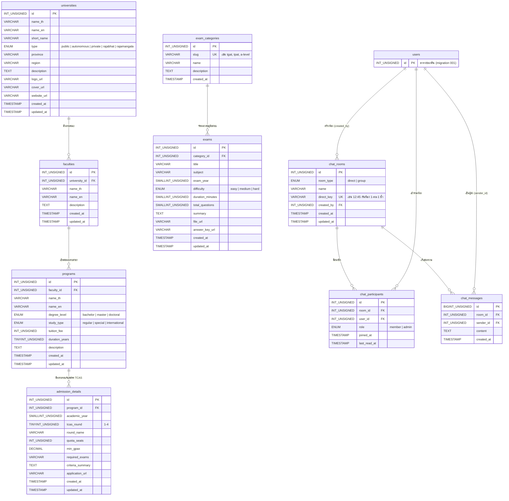

# UniGO! Entity Relationship Diagram (ERD)

> **สถานะเอกสาร:** ส่วนของ **บอล (University Explorer, Exam Library, Live Chat)**  
> ส่วนของ **คิน** (`users`, `profiles`, `posts`, `portfolios`, `saved`, `reports`, ฯลฯ) จะนำมาเติมรวมในไฟล์นี้ภายหลัง  
> **ข้อตกลงสำคัญสำหรับคิน:** ตาราง `chat_rooms`, `chat_participants`, `chat_messages` อ้างอิง Foreign Key ไปที่ `users(id)` โดยปัจจุบันกำหนดชนิดเป็น `INT UNSIGNED` *(กรุณาตรวจสอบให้ตรงกับ `users.id` ใน migration `001` ก่อน merge)*

---

## แผนภาพ ERD (ส่วนของบอล + จุดเชื่อม `users` ของคิน)

---

## สรุปความสัมพันธ์หลัก

1. **University Explorer (4 ตาราง):**
   - `universities` (1) → `faculties` (N): มหาวิทยาลัย 1 แห่งมีได้หลายคณะ
   - `faculties` (1) → `programs` (N): คณะ 1 คณะเปิดสอนได้หลายสาขา/หลักสูตร
   - `programs` (1) → `admission_details` (N): 1 สาขามีข้อมูลรับสมัครได้หลายรอบ (TCAS รอบ 1–4) และหลายปีการศึกษา
2. **Exam Library (2 ตาราง):**
   - `exam_categories` (1) → `exams` (N): หมวดหมู่ข้อสอบ 1 หมวด (เช่น `tgat`, `tpat`, `a-level`) มีข้อสอบได้หลายชุด
3. **Live Chat (3 ตาราง):**
   - `chat_rooms` ↔ `users` แบบ Many-to-Many ผ่านตารางกลาง `chat_participants` (กำหนด `UNIQUE(room_id, user_id)` กันเข้าห้องซ้ำ)
   - `chat_rooms.direct_key` เป็นค่า Unique เช่น `"3:15"` (เรียง `user_id` น้อยไปมาก) เพื่อการันตีว่าห้องแชต 1-ต่อ-1 ของคู่เดิมจะไม่ถูกสร้างซ้ำ
   - `chat_messages` ผูกกับ `chat_rooms(id)` และ `users(id)` เพื่อเก็บประวัติข้อความและผู้ส่ง

